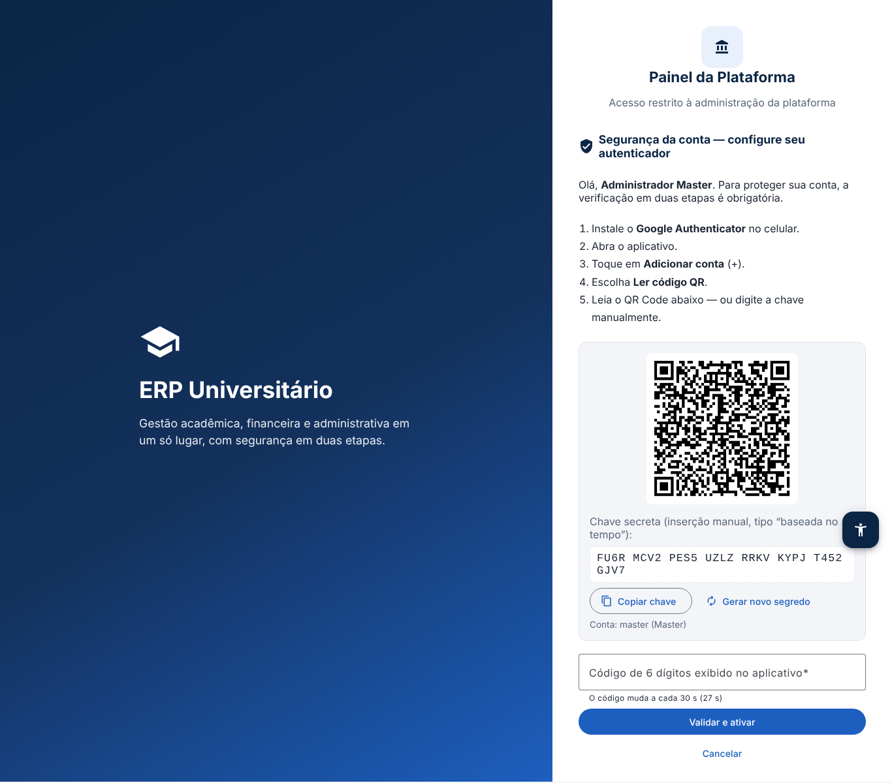
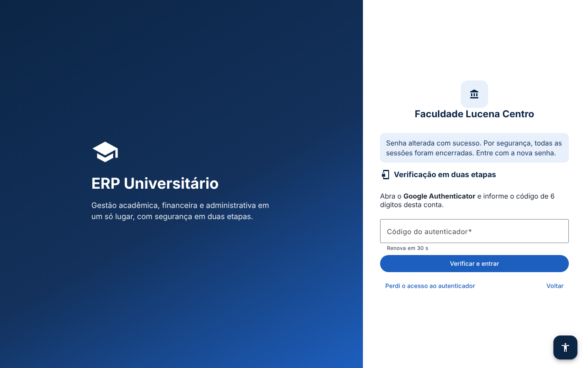
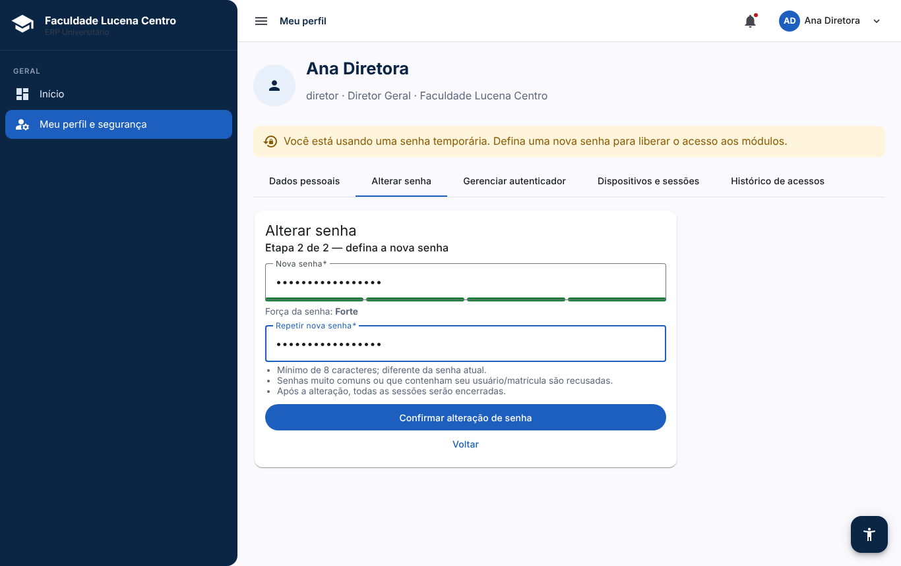
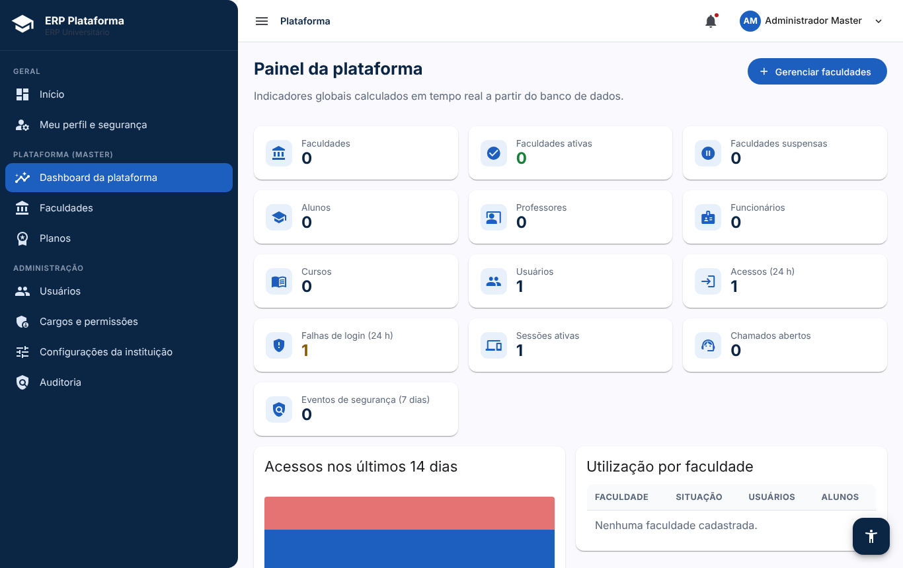
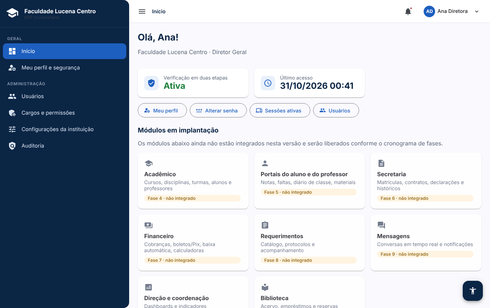
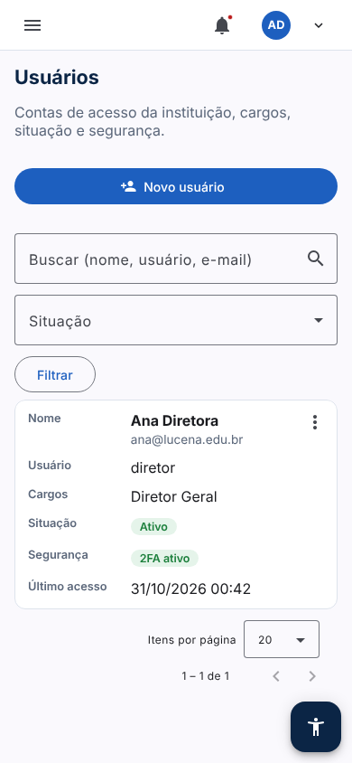

# ERP Universitário Lucena

ERP SaaS multi-faculdade para instituições de ensino superior particulares: gestão acadêmica, financeira,
administrativa e institucional, com isolamento entre faculdades e verificação em duas etapas obrigatória
(Google Authenticator / TOTP) para **todos** os usuários.

| Camada | Tecnologia |
|---|---|
| Frontend | Angular 20, TypeScript, Angular Material, layout responsivo |
| Backend | Java 21, Spring Boot 3.5, Spring Security, Spring Data JPA, Bean Validation, Maven |
| Banco | PostgreSQL 16 (fonte oficial dos dados acadêmicos e financeiros), migrations Flyway |
| Segurança | JWT curto + sessão no servidor, TOTP RFC 6238, Argon2id, AES-256-GCM |
| Firebase | Planejado para Storage (arquivos), FCM (push) e Firestore (tempo real) — ver [Arquitetura](docs/ARQUITETURA.md) |

## Status por fase

| Fase | Escopo | Status |
|---|---|---|
| 1 | Arquitetura, banco de dados (schema completo), multi-tenancy, autenticação | ✅ Entregue |
| 2 | Google Authenticator, códigos de recuperação, troca de dispositivo, step-up, segurança | ✅ Entregue |
| 3 | Painel Master, faculdades, planos, usuários, cargos e permissões, auditoria | ✅ Entregue |
| 4 | Cursos, disciplinas, alunos, professores, turmas | ⏳ Schema pronto, APIs/telas pendentes |
| 5–12 | Portais, secretaria, financeiro, requerimentos, mensagens, dashboards, biblioteca, relatórios | ⏳ Schema pronto, APIs/telas pendentes |

Módulos ainda não integrados aparecem na tela inicial como **"não integrado"** — não há botões decorativos.

## Executando localmente

Pré-requisitos: Java 21, Maven 3.9+, Node 22+, PostgreSQL 16.

```bash
# 1) Banco
sudo -u postgres psql -c "create user erp with password 'erp' createdb;" -c "create database erp owner erp;" -c "create database erp_test owner erp;"
```

```bash
# 2) Backend (perfil dev: chaves de desenvolvimento e Master inicial)
cd backend
mvn spring-boot:run -Dspring-boot.run.profiles=dev
```

```bash
# 3) Frontend (proxy /api -> :8080)
cd frontend
npm install
npm start
```

Acesse:

- Painel Master: http://localhost:4200/login — usuário `master`, senha `Lucena@Plataforma#2026` (somente perfil dev).
  No primeiro acesso, configure o Google Authenticator (QR Code ou chave).
- Login de uma faculdade: `http://localhost:4200/f/<identificador>/login` (o identificador é definido ao criar a faculdade).
- API documentada (OpenAPI/Swagger): http://localhost:8080/swagger-ui.html

## Testes

```bash
# Backend: unitários + integração contra PostgreSQL real (banco erp_test, recriado a cada execução)
cd backend && mvn verify
```

```bash
# Frontend: unitários (Karma/Jasmine, Chrome headless)
cd frontend && npm test -- --watch=false
```

```bash
# Ponta a ponta no navegador (Playwright; na primeira vez: npx playwright install chromium).
# Recria o banco dev, sobe o backend e testa o fluxo completo.
# Requer `npm start` rodando em :4200.
cd frontend && ./e2e/reset-and-run.sh e2e-screens
```

O E2E cobre: login com senha errada, primeiro acesso com configuração obrigatória do autenticador,
códigos de recuperação, criação de faculdade, primeiro acesso do Diretor com troca obrigatória de senha
(senha atual + código TOTP), recusa de senha que contém o usuário, segundo acesso pedindo só o código,
bloqueio do painel Master para usuários da faculdade, layout em celular sem rolagem horizontal e
painel de acessibilidade.

## Variáveis de ambiente (produção)

| Variável | Descrição |
|---|---|
| `ERP_DB_URL`, `ERP_DB_USER`, `ERP_DB_PASSWORD` | Conexão PostgreSQL |
| `ERP_JWT_SECRET` | **Obrigatória.** Base64 ≥ 32 bytes (`openssl rand -base64 48`) |
| `ERP_ENCRYPTION_KEY` | **Obrigatória.** Base64 de exatamente 32 bytes (`openssl rand -base64 32`). Cifra os segredos TOTP — guarde em cofre; perdê-la invalida todos os autenticadores |
| `ERP_COOKIE_SECURE` | `true` em produção (HTTPS) |
| `ERP_CORS_ORIGINS` | Origens permitidas do frontend, separadas por vírgula |
| `ERP_TOTP_ISSUER` | Nome exibido no Google Authenticator |
| `ERP_BREACHED_PASSWORD_CHECK` | `true` para recusar senhas vazadas (HaveIBeenPwned, k-anonymity) |
| `ERP_BOOTSTRAP_MASTER_USERNAME` / `_PASSWORD` / `_EMAIL` | Cria o primeiro Master se não existir nenhum |
| `ERP_AUTH_RATE_LIMIT` | Requisições/minuto por IP nos endpoints de autenticação (padrão 30) |

Documentação técnica detalhada: [docs/ARQUITETURA.md](docs/ARQUITETURA.md) e [docs/SEGURANCA.md](docs/SEGURANCA.md).

## Capturas (geradas pelo teste E2E)

| Primeiro acesso — Google Authenticator | Verificação em duas etapas | Alterar senha (etapa 2) |
|---|---|---|
|  |  |  |

| Painel Master | Início do Diretor | Celular — usuários |
|---|---|---|
|  |  |  |
